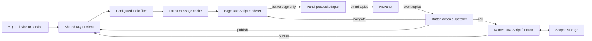

# NSPanel Manager MVP Plan

**Status:** Active implementation plan

**Stage 1 — Scripted plugin:** Working

**Stage 2 — Dyson hardware walkthrough:** Approved

**Stage 3 — Security and operations:** In progress

**Stage 4 — MQTT thermostat:** Implemented

**Stage 5 — Open-Meteo weather:** Implemented

**Stage 6 — Home-page lights and blinds:** Implemented

**Stage 7 — Sonos:** Implemented

**Stage 8 — Screen dimmer:** Implemented

**Stage 9 — Firmware and HMI delivery:** Planned for post-MVP

## Implementation Started

The generic scripted plugin and its editor are working. Reusable plugin profiles hold topic filters, pages, JavaScript renderers, named functions, and button actions; device instances reference a profile and supply their own variables. Startup MQTT subscriptions, scoped storage, script preview and syntax checks, debug logging, variable interpolation, and favorite bindings are implemented. Central Winston logging now writes size-limited, daily rotating files, with an authenticated Logs workspace for filtering records by category and severity. The generic runtime also supports firmware-native page integrations. The MQTT thermostat profile uses that contract for the panel's built-in thermostat page, with configurable MQTT topics, payload templates, value path, temperature bounds, and Up/Down step. Its actual temperature also updates the assigned panel's home-screen temperature. Dyson remains the first scripted example configuration; the runtime contains no Dyson-specific controls.

## Product Goal

NSPanel Manager should let a household configure one or more NSPanels and use them as flexible controls for the wider smart home. It replaces hand-maintained Node-RED flows for panel configuration, device state display, and device control. The long-term product should cover diverse devices through reusable plugins, generic MQTT entities, and user-authored flows.

The MVP targets the existing ESPHome firmware in `esphome/nsp-livingroom.yaml` and its current `esphome/panel4.yaml` include. Firmware flashing remains outside the MVP; manager-delivered Nextion HMI updates are tracked below.

## Current Baseline

The repository already contains an Angular 22 web client, an Express/TypeScript API, one shared MQTT connection, Docker deployment, panel profiles, and generic topic routes. Saving or manually applying a profile publishes it to `<nodeName>/cmnd/settings`; settings are also replayed when MQTT reconnects and when a panel publishes `booted` on `<nodeName>/event/display`. Routes can forward configured MQTT topics in either direction using simple payload templates.

Simple topic routes remain available, while scripted plugin instances provide interactive panel screens.

## Core Concepts

- **Panel:** A firmware device with a unique MQTT `nodeName`, saved settings, and supported screens and controls.
- **Entity:** A named device or value with a capability such as `switch`, `light`, `cover`, `sensor`, `climate`, or `media_player`. An entity has state, commands, and optional metadata.
- **Plugin definition:** A registered runtime capability, such as the generic scripted MQTT plugin or a later service integration.
- **Native panel page:** A firmware-owned screen, such as the thermostat page, which a compatible plugin instance can be assigned to. Its runtime receives panel events and sends translated state only while the page is open.
- **Plugin profile:** A named, reusable configuration for a plugin definition. It holds shared topic filters, pages, render functions, named functions, and button actions; for example, a Dyson profile can be used by multiple fans.
- **Plugin instance:** A device or service that references a plugin profile and supplies its own name and variables, such as `room` or `topic`. Instances can be bound independently to panel favorites.
- **Page:** A named screen configured on a plugin profile. Its JavaScript renderer runs with the selected instance's variables and state, and provides eight button slots matching the panel firmware.
- **Panel binding:** Connects one plugin instance to a panel favorite or a home-screen tile. Favorites open the plugin start page; light and cover tiles use the firmware's built-in detail screens.
- **Button action:** One of: open another page in the same instance, publish a configured MQTT topic and payload, or call a named JavaScript function.

## Runtime and Data Processing

The MQTT service owns the broker connection and dispatches message envelopes containing the topic, raw payload, QoS, retain flag, and receive time. Profile topic filters are expanded with each instance's variables; startup scripts can also register per-instance MQTT subscriptions. Each page's JavaScript renderer receives `message`, parsed `payload`, normalized `state`, a restricted `context`, `debug`, storage helpers, and `variables`. JSON payloads are parsed into objects or values in `message.payload` and `payload`; non-JSON payloads remain strings. A renderer returns a title, message, and up to eight button labels, or returns nothing to leave the panel display unchanged. Each slot's action is configured on the profile, so labels can change with device state while the button behavior remains explicit. The runtime caches incoming messages per instance even when the page is closed; it sends screen updates only to a panel with that instance's page open. Reopening a favorite renders from the latest cached message. A native-page integration gates page-specific updates on firmware page entry/exit, while integrations may send explicitly configured panel-wide values such as the thermostat's home-screen temperature.

Button actions navigate within the plugin instance, publish a configured MQTT message, or call a named function. Functions receive a restricted context for MQTT publishing and global/plugin/panel storage; they cannot create independent broker clients. QuickJS isolates user code and applies time, memory, stack, and source-size limits; filesystem, process, and arbitrary network APIs are not exposed. HTTP-backed services such as weather can later feed messages into the same page-rendering contract.

Keep panel protocol handling in an adapter so plugins and flows work with domain concepts, while the adapter handles firmware topic names and payload shapes. The first adapter targets the current YAML contract: settings on `cmnd/settings`, screen updates through supported `cmnd/...` topics, and panel input on `event/...` topics. In particular, `cmnd/info` renders a title, message, and button actions; the firmware processes up to eight buttons and emits `event/infobutton/{index}` events with the screen topic and selected action. The adapter should also support the existing message, universal page, weather, and music commands where their payload contracts are confirmed.

On panel boot, send the saved profile and restore an active page if its session is still valid. Cache the latest matched message so a page can render after the source has gone quiet. A firmware sleep event clears the active panel session; later MQTT messages update the cache without waking the panel. Keep state ingestion, panel events, and outbound device commands distinct to avoid command loops.

## Plugin and Flow Contract

The generic scripted plugin declares its ID and version. A reusable profile configures topic filters, startup subscriptions, page render functions, named functions, and eight action slots per page; each instance selects that profile and provides independent variables. A render function receives `{ message, payload, state, context, debug, mqtt, global, panel, variables, fnct }`; `message` contains `{ topic, payload, qos, retain, receivedAt }`, with JSON payloads parsed and non-JSON payloads kept as strings. Named functions define comma-separated parameters and return values to their caller through `fnct.functionId(arg1, arg2)`. Scripts can use `isEqual(value1, value2)` to recursively compare JSON objects and arrays without depending on object key order. Use `debug.log(...)` to capture diagnostics in the page preview or write them to the manager log during live rendering. Return `{ title, message, buttons }`, where `buttons` contains up to eight labels (empty labels leave slots unused), or return nothing to skip the display update. Each returned label maps by index to that page's configured action. Button actions support page navigation, fixed MQTT topic/payload publishing, and named function calls. Named functions can call `mqtt.send(topic, payload)` with a string or JSON payload, read/write durable values with `global.get/set` and `panel.get/set(panelName, ...)`, or use the existing `context` helpers. Scripts can use `gotopage(name)` and `reloadpage(name)` to navigate, and `{{variable}}` in script strings or MQTT action topics/payloads to use instance values. Requested writes and publishes are applied by the manager after the function returns. The manager validates topic filters, publishable topics, page references, action types, and script inputs, and owns all network clients and lifecycle.

For Dyson, one reusable profile reads parsed `message.payload.product-state.fnsp` and `message.payload.product-state.fpwr`, then returns status text and button labels. Multiple fan instances can share it while setting different topic variables. A speed button can open a `speed` page; that page can have four MQTT actions with payloads such as `{"fpwr":"ON","fnsp":"0001"}`. A power button can call `togglePower`, which reads the cached status and uses `mqtt.send(...)`. Device-specific topic values remain on each instance.

An incoming message invokes the matching page renderer. If that page is currently open on a panel, the returned model is sent through the panel adapter; otherwise it updates the cache only. Opening a page runs the renderer against the latest cached envelope. A panel button dispatches its configured action: page navigation, MQTT publish, or named function call. Function calls may publish messages through the supplied context and update scoped storage. The MVP must require authenticated administrator access to edit scripts or run them.

Storage scopes are:

- **Global:** shared household values and flow data.
- **Plugin instance:** values shared by pages and panels using that configured instance.
- **Panel:** values private to one panel, including multi-step flows.

Configuration and secrets remain server-side. For the MVP, the latest normalized MQTT message state was held in memory while panel flow sessions and script-selected values were persisted. The manager now also persists a bounded last-known state snapshot for device plugin instances, coalesced into at most one runtime snapshot write per second. Device state is capped at 512 instances, 2 MiB total, and 64 KiB per instance; script storage remains capped at 4,096 values and 2 MiB total, with a 64 KiB maximum per value. These durable values live in the private runtime-state file under the configured data directory, separate from panel and broker profiles.

## Web UI

The Angular 22 standalone client is organized by feature. The plugin editor manages reusable profiles separately from device instances and their variables. Profiles expose MQTT filters, pages, JavaScript render/named functions, and table-configured button actions. JavaScript bodies use CodeMirror 6 with JavaScript highlighting. Action rows select a page, MQTT publish, or named function; instances can be bound independently to panel favorites. Native page instances are assigned in panel settings, separately from favorites. Main-screen tiles can be assigned to an MQTT light or cover instance, then configured independently for on/off or level controls and a toggle or built-in detail-page action. The MQTT thermostat profile exposes topic/value templates and temperature limits for the firmware's built-in thermostat page. The editor checks script syntax and previews the current unsaved profile values against a sample topic and payload without publishing or changing saved settings. Preview output includes `debug.log(...)` lines. Continue using signals and built-in `@if`/`@for` control flow, with component TypeScript, HTML, and CSS in separate files.

## First Vertical Slice: Fan Control

Build the first integration as a reusable scripted MQTT profile configured for Dyson fans. Subscribe to each instance's state topic filter and pass full messages to the page renderer. The function can read Dyson's `product-state` fields, take the latest element from previous/current arrays, and turn `fnsp: "0004"` into a human-readable `40%` status. Configure button slots for power, speed-page navigation, rotation, humidity, and other actions. A direct MQTT action can send `{"fpwr":"ON","fnsp":"0001"}`; a named function can calculate a payload and call `mqtt.send(...)`. The same profile should control multiple fans by assigning different topic and device variables to their instances. The fan's behavior belongs in the profile's scripts and actions, not a dedicated fan renderer.

The user opens the configured start page from a panel favorite. The renderer supplies the current title, message, and button labels. Button actions navigate to other pages, publish configured MQTT messages, or call named functions. Incoming device messages always update the latest-message cache, but refresh the panel only while its plugin page is open. Back or the firmware sleep event closes that session, so regular telemetry cannot keep the screen awake; opening the favorite again renders the latest cached message. External-to-panel routes targeting `cmnd/info` or `cmnd/nextion` follow the same session gate.

## First Hardware Walkthrough — Approved

The user confirmed that the scripted Dyson flow works well on the available hardware and approved this stage. It established the reusable message, script, MQTT, and panel-session model used by the later thermostat, weather, light, and cover integrations.

The walkthrough covers opening the configured start page from a favorite, rendering current Dyson state, configuring the eight button slots, publishing from named functions, gating state refreshes to an open page, closing on sleep, and Back navigation. The user has approved the stage; these behaviors form the reusable contract for the implemented thermostat, blinds, weather, and upcoming Sonos integrations.

## Security Implementation Progress

The API now has a local administrator store with normalized unique emails, Argon2id password hashes, revocable HttpOnly sessions, login throttling, and account management. A one-time browser onboarding wizard creates and signs in the first administrator; its API endpoint permanently closes after that account is saved. SSO never provisions users. Optional OIDC uses authorization code flow with state, nonce, and PKCE. First-time linking requires a verified provider email matching an enabled local account, then subsequent logins use the stored issuer and subject pair. OIDC settings are supplied through deployment environment values and the client secret is mounted from a Docker secret file. The MQTT broker password is encrypted at rest with AES-256-GCM, using a key mounted from a secret file outside the data volume; legacy plaintext passwords are encrypted during startup migration. The authenticated log viewer and streamed ZIP download of `DATA_DIR` are implemented. Restore is a documented manual operation; deployment secrets remain separately backed up.

User-authored JavaScript is part of the scripted-plugin slice, not a later visual-flow milestone. QuickJS runs each function in a limited evaluation context; the manager exposes message data, read-only render context, and explicitly enabled publish/storage effects. See the [QuickJS-emscripten documentation](https://github.com/justjake/quickjs-emscripten) for its limits and evaluation model.

## Project Milestones

1. **Scripted plugin — Working.** Reusable profiles and per-device instances, script editor, MQTT subscriptions and actions, page preview, syntax feedback, scoped storage, and favorite bindings are implemented.
2. **First hardware walkthrough — Approved.** The user confirmed the scripted Dyson flow works well on the available hardware.
3. **Security and operations — In progress.** One-time browser onboarding, local email/password accounts, Argon2id password hashes, administrator account management, revocable sessions, protected APIs, optional OIDC login, encrypted MQTT broker credentials, the authenticated rotating-log viewer, and a streamed ZIP download of `DATA_DIR` are implemented. OIDC is configured with issuer URL, client ID, and client secret file; the callback URL is derived from `APP_PUBLIC_URL`. SSO authenticates a user only when its verified email matches an enabled local account, then uses issuer plus `sub` for later logins. The broker credential key is generated separately and mounted as a Docker secret outside the manager data volume. Restore is a documented manual operation; validate the procedure against a real Docker volume before relying on it for recovery.
4. **MQTT thermostat — Implemented.** Reusable profile and per-device instance variables, configurable status/request/set topics, JSON value extraction, temperature bounds and step, payload templates for requests/setpoints/modes, panel assignment to the native thermostat screen, and page-specific MQTT refresh gating. Firmware `up` and `dn` events adjust the latest target temperature by the configured delta and clamp it to the configured bounds. Changed actual temperature also updates the assigned panel's home-screen temperature. The first profile is configured for Homematic topics, while its fields support other topic and payload conventions.
5. **Open-Meteo weather — Implemented.** A reusable service profile polls current conditions and a five-day forecast; each instance supplies latitude, longitude, and an optional timezone. The manager translates service data to the firmware weather payload, caches changed data, sends it only while the native weather page is open, and replays the forecast when the page opens. The panel can assign a weather instance independently for each location.
6. **Lights and blinds on the panel home page — Implemented.** Reusable MQTT light and cover plugins can be assigned to any of the four home tiles. Panel settings configure each tile's `image`, `mode`, and `label`; icon IDs 0–6 represent lamp, bulb, downlight, desk lamp, outdoor lamp, blind, and curtain. Mode 0 shows up/down controls and toggles on the center press, mode 1 opens the level page, and mode 2 toggles without up/down controls. A long press on an assigned light opens the brightness/color screen. Plugin profiles configure status filters, value paths, request/set topics, payload templates, endpoint labels for 0%/100%, brightness steps and conversion ranges, position bounds, and level presets. Brightness values map between the configured MQTT minimum/maximum and the panel's 0–100 scale; set the maximum to 255 for Hue brightness. Color wheel RGB triplets are converted to canonical hue 0–360 and saturation 0–100%, then each is scaled into the configured device minimum/maximum; the default maxima are 255 for Philips Hue. Optional instance variables `PSET1` and `PSET2` supply raw preset payloads. While the home screen is visible, the runtime translates each light or cover state to a display label and sends only that label to `<nodeName>/cmnd/status`. When the level page opens, its zero-based `<nodeName>/event/level/{button}` query resolves the bound tile instance, publishes its configured state request when present, and sends the cached position as a numeric payload to `<nodeName>/cmnd/level/status`; later device updates refresh the level. The local `panel4.yaml` include implements this contract.
7. **Sonos — Implemented.** Shared player state, panel player selection, playback and volume commands, favorites handoff, and join/leave group actions use the existing MQTT bridge.
8. **Screen dimmer — Implemented.** Panel page events can be assigned to a screen-dimmer instance that sets Nextion brightness by page.
9. **Firmware and HMI delivery — In progress.** Single-panel Nextion HMI upload and delivery are implemented. ESPHome firmware OTA and observable multi-panel rollouts remain planned.

## MVP Acceptance Criteria

- Configure multiple panels with unique node names, save profiles, and automatically resend settings after a panel boot.
- Save a reusable plugin profile, configure multiple instances with different variables, and bind each instance independently to a panel favorite.
- Match incoming MQTT messages with configured topic filters and pass the full envelope to a JavaScript renderer that returns a title, message, and up to eight button labels.
- Configure every button as page navigation, MQTT topic/payload publishing, or a named function call; named functions can publish through the manager context.
- Build the Dyson fan flow from a reusable plugin profile and per-instance variables, with no fan-specific screen implementation in the runtime.
- Configure reusable thermostat profiles for different MQTT conventions, assign an instance to a panel's built-in thermostat page, and map current/target values plus temperature and mode actions to external MQTT topics.
- When the assigned thermostat reports a changed actual temperature, update the panel's home-screen temperature through `<nodeName>/cmnd/temperature/current` without sending thermostat-page updates while that page is closed.
- Bind reusable light and blind instances independently to any of the four panel home-page tiles, with firmware icon and mode configured on the panel and display labels derived from current device state.
- Show the latest light or blind state on the home page and map tile actions to light toggle, brightness, and color or blind open, close, stop, and position commands.
- Send state updates only while the panel is displaying its home page or the matching built-in detail screen; replay cached state when it returns.
- Cache status updates while a page is closed, render the latest message when opened, and stop sending screen updates after Back or firmware sleep.
- Persist active flow context and scoped values across manager restarts, with errors visible to the administrator.
- Require administrator authentication through the configured OIDC provider for configuration changes and user-authored flow execution; define an explicit recovery path for provider outages.
- Store local users with a normalized unique email, enabled status, and Argon2id password hash; local users are manager administrators in the MVP. Support email/password login when SSO is disabled or unavailable.
- Support an optional OIDC issuer URL, client ID, and client secret; derive the registered callback URL from `APP_PUBLIC_URL`. Link an SSO identity to an existing enabled local user only when the provider asserts a verified email matching that account; do not auto-provision users.
- After initial email matching, identify the linked SSO account by issuer and OIDC subject (`sub`), so a later email change cannot silently transfer access.
- Keep SSO client secrets and the credential-encryption key outside the data volume, hash any local recovery password with a password-hashing algorithm, and encrypt reusable broker/API credentials at rest.
- Run the API and Angular client together in Docker with configuration, secrets, and state stored on a persistent volume.

## Decisions for Later Milestones

- Should firmware artifacts be uploaded per panel, or should the manager build target-specific images from a shared ESPHome configuration?

## Post-MVP Roadmap: Firmware and HMI Delivery

Add an authenticated firmware and HMI workspace for administrators to upload artifacts, assign them to registered panels, and track each panel's update result. Keep firmware binaries and Nextion `.tft` files as separate artifact types.

### ESPHome Firmware Updates

- Upload an ESPHome OTA-format firmware image, record its version, checksum, target, and compatible panel profile, then select one or more panels for rollout. Panel builds can embed `node_name`, `hostname`, IP, and secrets, so the manager must prevent sending a target-specific image to an incompatible panel.
- Avoid adding `esphome-cli` to the manager runtime. Add ESPHome's `http_request` OTA platform and an MQTT-triggered update action to the firmware. The manager hosts a short-lived, authenticated download URL and asks each selected panel to pull the image. The ESPHome `http_request` OTA platform is designed for this device-initiated flow and requires an OTA-format image: [ESPHome HTTP-request OTA](https://esphome.io/components/ota/http_request/).
- Existing panels need one bootstrap firmware update through the current ESPHome OTA workflow before manager-triggered HTTP updates are available. Retain native ESPHome OTA as a recovery option. Roll out sequentially, report per-panel progress, and confirm the panel returns online and resumes heartbeats after reboot.

### Nextion HMI Updates

- Upload and version `.tft` assets independently from ESP firmware, associate each asset with compatible panel/HMI profiles, and select target panels for an update.
- The manager now sends a runtime URL; firmware sets the Nextion driver's URL with `set_tft_url()` before its existing `upload_tft()` flow. The current static URL remains a fallback for legacy update commands; see the [ESPHome Nextion upload documentation](https://esphome.io/components/display/nextion/).
- Implemented single-panel HMI update tracking: the workspace stores the latest `.tft`, sends a six-hour capability URL and job ID over MQTT, and retains up to 200 update records in runtime state. Panel5 reports confirmation, update start, cancellation, and transfer failure; matching heartbeat checksum confirms success. The authenticated same-origin WebSocket sends initial panel/job state and live changes, so panel and HMI status views do not poll. The HMI page shows recent outcomes and supports retries after terminal failures. Reported hashes cover manager-delivered updates and do not detect TFT files flashed outside the manager. Remaining work includes associating HMI versions with panel profiles and staged multi-panel rollouts.

### Rollout and Recovery

- Start with one selected panel, then allow batches with a configurable delay between panels. Do not send a settings refresh during an update.
- Persist artifact metadata and update-job history in the manager data directory, while keeping download URLs temporary and credentials protected.
- Document USB/serial recovery for panels that cannot reconnect after an update. Validate firmware and HMI updates on a test panel before enabling broad rollouts.

## Out of Scope for the MVP

- Firmware flashing, OTA management, and changing the panel's TFT assets are out of the MVP and planned as a post-MVP milestone.
- A plugin marketplace or third-party package installation.
- A visual drag-and-drop automation editor.
- Integrations for every smart-home platform; generic MQTT entities and the plugin contract provide the extension path.
