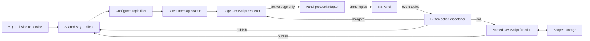

# NSPanel Manager MVP Plan

**Status:** Active implementation plan

**Stage 1 — Scripted plugin:** Working

**Stage 2 — Dyson hardware walkthrough:** Approved

## Implementation Started

The generic scripted plugin and its editor are working. Reusable plugin profiles hold topic filters, pages, JavaScript renderers, named functions, and button actions; device instances reference a profile and supply their own variables. Startup MQTT subscriptions, scoped storage, script preview and syntax checks, debug logging, variable interpolation, and favorite bindings are implemented. Dyson remains the first example configuration; the runtime contains no Dyson-specific controls. The user has approved the hardware walkthrough.

## Product Goal

NSPanel Manager should let a household configure one or more NSPanels and use them as flexible controls for the wider smart home. It replaces hand-maintained Node-RED flows for panel configuration, device state display, and device control. The long-term product should cover diverse devices through reusable plugins, generic MQTT entities, and user-authored flows.

The MVP targets the existing ESPHome firmware in `esphome/nsp-livingroom.yaml` and `esphome/panel3.yaml`. Firmware flashing and OTA updates are out of scope for this release.

## Current Baseline

The repository already contains an Angular 22 web client, an Express/TypeScript API, one shared MQTT connection, Docker deployment, panel profiles, and generic topic routes. Profiles are sent to `<nodeName>/cmnd/settings` when applied and when a panel publishes `booted` on `<nodeName>/event/display`. Routes can forward configured MQTT topics in either direction using simple payload templates.

Simple topic routes remain available, while scripted plugin instances provide interactive panel screens.

## Core Concepts

- **Panel:** A firmware device with a unique MQTT `nodeName`, saved settings, and supported screens and controls.
- **Entity:** A named device or value with a capability such as `switch`, `light`, `cover`, `sensor`, `climate`, or `media_player`. An entity has state, commands, and optional metadata.
- **Plugin definition:** A registered runtime capability, such as the generic scripted MQTT plugin or a later service integration.
- **Plugin profile:** A named, reusable configuration for a plugin definition. It holds shared topic filters, pages, render functions, named functions, and button actions; for example, a Dyson profile can be used by multiple fans.
- **Plugin instance:** A device or service that references a plugin profile and supplies its own name and variables, such as `room` or `topic`. Instances can be bound independently to panel favorites.
- **Page:** A named screen configured on a plugin profile. Its JavaScript renderer runs with the selected instance's variables and state, and provides eight button slots matching the panel firmware.
- **Panel binding:** Connects one plugin instance to a panel favorite. The binding opens that instance's configured start page.
- **Button action:** One of: open another page in the same instance, publish a configured MQTT topic and payload, or call a named JavaScript function.

## Runtime and Data Processing

The MQTT service owns the broker connection and dispatches message envelopes containing the topic, raw payload, QoS, retain flag, and receive time. Profile topic filters are expanded with each instance's variables; startup scripts can also register per-instance MQTT subscriptions. Each page's JavaScript renderer receives `message`, parsed `payload`, normalized `state`, a restricted `context`, `debug`, storage helpers, and `variables`. JSON payloads are parsed into objects or values in `message.payload` and `payload`; non-JSON payloads remain strings. A renderer returns a title, message, and up to eight button labels, or returns nothing to leave the panel display unchanged. Each slot's action is configured on the profile, so labels can change with device state while the button behavior remains explicit. The runtime caches incoming messages per instance even when the page is closed; it sends screen updates only to a panel with that instance's page open. Reopening a favorite renders from the latest cached message.

Button actions navigate within the plugin instance, publish a configured MQTT message, or call a named function. Functions receive a restricted context for MQTT publishing and global/plugin/panel storage; they cannot create independent broker clients. QuickJS isolates user code and applies time, memory, stack, and source-size limits; filesystem, process, and arbitrary network APIs are not exposed. HTTP-backed services such as weather can later feed messages into the same page-rendering contract.

Keep panel protocol handling in an adapter so plugins and flows work with domain concepts, while the adapter handles firmware topic names and payload shapes. The first adapter targets the current YAML contract: settings on `cmnd/settings`, screen updates through supported `cmnd/...` topics, and panel input on `event/...` topics. In particular, `cmnd/info` renders a title, message, and button actions; the firmware processes up to eight buttons and emits `event/infobutton/{index}` events with the screen topic and selected action. The adapter should also support the existing message, universal page, weather, and music commands where their payload contracts are confirmed.

On panel boot, send the saved profile and restore an active page if its session is still valid. Cache the latest matched message so a page can render after the source has gone quiet. A firmware sleep event clears the active panel session; later MQTT messages update the cache without waking the panel. Keep state ingestion, panel events, and outbound device commands distinct to avoid command loops.

## Plugin and Flow Contract

The generic scripted plugin declares its ID and version. A reusable profile configures topic filters, startup subscriptions, page render functions, named functions, and eight action slots per page; each instance selects that profile and provides independent variables. A render function receives `{ message, payload, state, context, debug, mqtt, global, panel, variables, fnct }`; `message` contains `{ topic, payload, qos, retain, receivedAt }`, with JSON payloads parsed and non-JSON payloads kept as strings. Named functions define comma-separated parameters and return values to their caller through `fnct.functionId(arg1, arg2)`. Scripts can use `isEqual(value1, value2)` to recursively compare JSON objects and arrays without depending on object key order. Use `debug.log(...)` to capture diagnostics in the page preview or write them to the manager log during live rendering. Return `{ title, message, buttons }`, where `buttons` contains up to eight labels (empty labels leave slots unused), or return nothing to skip the display update. Each returned label maps by index to that page's configured action. Button actions support page navigation, fixed MQTT topic/payload publishing, and named function calls. Named functions can call `mqtt.send(topic, payload)` with a string or JSON payload, read/write durable values with `global.get/set` and `panel.get/set(panelName, ...)`, or use the existing `context` helpers. Scripts can use `gotopage(name)` and `reloadpage(name)` to navigate, and `{{variable}}` in script strings or MQTT action topics/payloads to use instance values. Requested writes and publishes are applied by the manager after the function returns. The manager validates topic filters, publishable topics, page references, action types, and script inputs, and owns all network clients and lifecycle.

For Dyson, one reusable profile reads parsed `message.payload.product-state.fnsp` and `message.payload.product-state.fpwr`, then returns status text and button labels. Multiple fan instances can share it while setting different topic variables. A speed button can open a `speed` page; that page can have four MQTT actions with payloads such as `{"fpwr":"ON","fnsp":"0001"}`. A power button can call `togglePower`, which reads the cached status and uses `mqtt.send(...)`. Device-specific topic values remain on each instance.

An incoming message invokes the matching page renderer. If that page is currently open on a panel, the returned model is sent through the panel adapter; otherwise it updates the cache only. Opening a page runs the renderer against the latest cached envelope. A panel button dispatches its configured action: page navigation, MQTT publish, or named function call. Function calls may publish messages through the supplied context and update scoped storage. The MVP must require authenticated administrator access to edit scripts or run them.

Storage scopes are:

- **Global:** shared household values and flow data.
- **Plugin instance:** values shared by pages and panels using that configured instance.
- **Panel:** values private to one panel, including multi-step flows.

Configuration and secrets remain server-side. The MVP keeps the latest normalized MQTT message state in memory and persists panel flow sessions plus script values only when a script explicitly calls `global.set`, `plugin.set`, or `panel.set`. Script storage mutations update memory immediately and are coalesced into at most one runtime snapshot write per second. Script storage is capped at 4,096 values and 2 MiB total, with a 64 KiB maximum per value, so a changing MQTT stream cannot create one disk write per message or grow the stored values without limit. These durable values live in the private runtime-state file under the configured data directory, separate from panel and broker profiles.

## Web UI

The Angular 22 standalone client is organized by feature. The plugin editor manages reusable profiles separately from device instances and their variables. Profiles expose MQTT filters, pages, JavaScript render/named functions, and table-configured button actions. JavaScript bodies use CodeMirror 6 with JavaScript highlighting. Action rows select a page, MQTT publish, or named function; instances can be bound independently to panel favorites. The editor checks script syntax and previews the current unsaved profile values against a sample topic and payload without publishing or changing saved settings. Preview output includes `debug.log(...)` lines. Continue using signals and built-in `@if`/`@for` control flow, with component TypeScript, HTML, and CSS in separate files.

## First Vertical Slice: Fan Control

Build the first integration as a reusable scripted MQTT profile configured for Dyson fans. Subscribe to each instance's state topic filter and pass full messages to the page renderer. The function can read Dyson's `product-state` fields, take the latest element from previous/current arrays, and turn `fnsp: "0004"` into a human-readable `40%` status. Configure button slots for power, speed-page navigation, rotation, humidity, and other actions. A direct MQTT action can send `{"fpwr":"ON","fnsp":"0001"}`; a named function can calculate a payload and call `mqtt.send(...)`. The same profile should control multiple fans by assigning different topic and device variables to their instances. The fan's behavior belongs in the profile's scripts and actions, not a dedicated fan renderer.

The user opens the configured start page from a panel favorite. The renderer supplies the current title, message, and button labels. Button actions navigate to other pages, publish configured MQTT messages, or call named functions. Incoming device messages always update the latest-message cache, but refresh the panel only while its plugin page is open. Back or the firmware sleep event closes that session, so regular telemetry cannot keep the screen awake; opening the favorite again renders the latest cached message. External-to-panel routes targeting `cmnd/info` or `cmnd/nextion` follow the same session gate.

## First Hardware Walkthrough — Approved

The user confirmed that the scripted Dyson flow works well on the available hardware and approved this stage. The next milestone is security and operations.

The walkthrough covers opening the configured start page from a favorite, rendering current Dyson state, configuring the eight button slots, publishing from named functions, gating state refreshes to an open page, closing on sleep, and Back navigation. The user has approved the stage; these behaviors form the reusable contract for thermostat, blinds, weather, and Sonos configurations.

## Security Implementation Progress

The API now has a local administrator store with normalized unique emails, Argon2id password hashes, revocable HttpOnly sessions, login throttling, and account management. A one-time browser onboarding wizard creates and signs in the first administrator; its API endpoint permanently closes after that account is saved. SSO never provisions users. Optional OIDC uses authorization code flow with state, nonce, and PKCE. First-time linking requires a verified provider email matching an enabled local account, then subsequent logins use the stored issuer and subject pair. OIDC settings are supplied through deployment environment values and the client secret is mounted from a Docker secret file. The MQTT broker password is now encrypted at rest with AES-256-GCM, using a key mounted from a secret file outside the data volume; legacy plaintext passwords are encrypted during startup migration. Live activity diagnostics and volume recovery remain to complete this milestone.

User-authored JavaScript is part of the scripted-plugin slice, not a later visual-flow milestone. QuickJS runs each function in a limited evaluation context; the manager exposes message data, read-only render context, and explicitly enabled publish/storage effects. See the [QuickJS-emscripten documentation](https://github.com/justjake/quickjs-emscripten) for its limits and evaluation model.

## MVP Scope and Milestones

1. **Scripted plugin — Working.** Reusable profiles and per-device instances, script editor, MQTT subscriptions and actions, page preview, syntax feedback, scoped storage, and favorite bindings are implemented.
2. **First hardware walkthrough — Approved.** The user confirmed the scripted Dyson flow works well on the available hardware.
3. **Security and operations — In progress.** One-time browser onboarding, local email/password accounts, Argon2id password hashes, administrator account management, revocable sessions, protected APIs, optional OIDC login, and encrypted MQTT broker credentials are implemented. OIDC is configured with issuer URL, client ID, and client secret file; the callback URL is derived from `APP_PUBLIC_URL`. SSO authenticates a user only when its verified email matches an enabled local account, then uses issuer plus `sub` for later logins. The broker credential key is generated separately and mounted as a Docker secret outside the manager data volume. Remaining work: add live activity/error diagnostics and confirm durable Docker-volume storage and recovery behavior.
4. **Additional integrations — Planned.** Reuse the model for thermostats, blinds/covers, weather, and Sonos.

## MVP Acceptance Criteria

- Configure multiple panels with unique node names, save profiles, and automatically resend settings after a panel boot.
- Save a reusable plugin profile, configure multiple instances with different variables, and bind each instance independently to a panel favorite.
- Match incoming MQTT messages with configured topic filters and pass the full envelope to a JavaScript renderer that returns a title, message, and up to eight button labels.
- Configure every button as page navigation, MQTT topic/payload publishing, or a named function call; named functions can publish through the manager context.
- Build the Dyson fan flow from a reusable plugin profile and per-instance variables, with no fan-specific screen implementation in the runtime.
- Cache status updates while a page is closed, render the latest message when opened, and stop sending screen updates after Back or firmware sleep.
- Persist active flow context and scoped values across manager restarts, with errors visible to the administrator.
- Require administrator authentication through the configured OIDC provider for configuration changes and user-authored flow execution; define an explicit recovery path for provider outages.
- Store local users with a normalized unique email, enabled status, and Argon2id password hash; local users are manager administrators in the MVP. Support email/password login when SSO is disabled or unavailable.
- Support an optional OIDC issuer URL, client ID, and client secret; derive the registered callback URL from `APP_PUBLIC_URL`. Link an SSO identity to an existing enabled local user only when the provider asserts a verified email matching that account; do not auto-provision users.
- After initial email matching, identify the linked SSO account by issuer and OIDC subject (`sub`), so a later email change cannot silently transfer access.
- Keep SSO client secrets and the credential-encryption key outside the data volume, hash any local recovery password with a password-hashing algorithm, and encrypt reusable broker/API credentials at rest.
- Run the API and Angular client together in Docker with configuration, secrets, and state stored on a persistent volume.

## Decisions for Later Milestones

- Which weather service and credential model should the first weather plugin use?
- Should Sonos connect through an existing MQTT integration or directly to the local Sonos API?

## Out of Scope for the MVP

- Firmware flashing, OTA management, and changing the panel's TFT assets.
- A plugin marketplace or third-party package installation.
- A visual drag-and-drop automation editor.
- Integrations for every smart-home platform; generic MQTT entities and the plugin contract provide the extension path.
