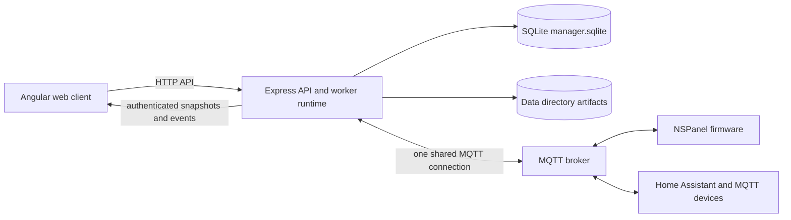

# NSPanel Manager Developer Guide

This guide is for developers changing the manager, its MQTT integrations, or the ESPHome firmware. It complements the operator instructions in the root [README](../README.md), the [plugin runtime guide](plugin-system.md), and the [localization guide](localization.md).

## System overview

NSPanel Manager is a pnpm workspace with an Angular client and a TypeScript API. The API currently owns the HTTP server, authenticated WebSocket server, MQTT client/runtime, plugin dispatch, update jobs, and scheduled backups in one Node.js process. Runtime process separation is intentionally deferred while the current deployment is operating reliably.



The manager is the configuration and transport coordinator. Plugins translate device messages to normalized state and panel commands; the firmware owns the screen rendering and touch input. The manager does not open a broker connection per plugin.

## Workspace map

| Path | Responsibility |
| --- | --- |
| `apps/api/src/server.ts` | Startup order, service wiring, event connections, and graceful shutdown. |
| `apps/api/src/app.ts` | Express middleware, authentication boundary, router mounts, static client hosting, and error responses. |
| `apps/api/src/routes/` | Broker, panel, and MQTT route endpoints. |
| `apps/api/src/features/` | Feature services and routers for auth, plugins, persistence, backups, logs, HMI, firmware, runtime state, and WebSockets. |
| `apps/api/src/domain/` | Configuration normalization and validation that should not depend on HTTP or MQTT transport. |
| `apps/api/src/services/mqtt-runtime.ts` | The shared MQTT connection, topic subscriptions, panel protocol coordination, plugin dispatch, and command publishing. |
| `apps/api/src/services/sqlite-store.ts` | SQLite initialization, schema migration, JSON-document persistence, revision transactions, and consistent database snapshots. |
| `apps/api/src/types.ts` | Shared API and persisted configuration contracts. |
| `apps/web/src/app.component.*` | Authenticated workspace shell, navigation, theme, and feature-page selection. |
| `apps/web/src/app/manager-store.service.ts` | Typed HTTP client, Angular signal state, WebSocket connection, and API event application. |
| `apps/web/src/app/features/` | Standalone feature pages split into TypeScript, HTML, and CSS. |
| `apps/web/public/assets/i18n/` | Runtime-loaded translation JSON and the language catalog. |
| `esphome/nspanel-unified.yaml` | Entry point for the current unified panel firmware. It loads `panel-unified.yaml`. |
| `esphome/` | Legacy firmware entries, shared packages, HMI source, and compile scripts. |
| `scripts/` | Firmware versioning, compile, package, and helper scripts. |
| `docs/` | Operator and developer notes, feature design, reviews, and migration records. |

## Startup, request, and event lifecycle

### Process startup

`server.ts` wires dependencies in this order:

1. Create the logger and persistent directories.
2. Load the encryption key and initialize the SQLite database.
3. Load and normalize manager configuration, runtime state, and users. Existing JSON documents are imported once and retained as recovery copies.
4. Initialize backup, HMI, firmware, and crash-dump artifact services.
5. Initialize authentication and the built-in plugin registry.
6. Create the single `MqttRuntime`, update services, Express app, HTTP server, and authenticated WebSocket server.
7. Connect MQTT, start update/backup schedulers, and register shutdown handlers.

On shutdown the manager stops schedulers and update services, closes WebSockets and HTTP, disconnects MQTT, flushes the coalesced runtime snapshot, then closes SQLite and logging. Preserve this ordering when adding a long-lived service.

### HTTP requests

`createApp()` applies JSON parsing and same-origin checks before private API routers. Authentication routes and expiring HMI/firmware download links are mounted before the authenticated-user guard because they have their own access rules. All configuration and administration routes are behind that guard. Feature routers validate the request, persist through their service/store, then refresh the relevant runtime behavior. The final API error handler logs structured context and returns a safe error response.

New manager APIs belong in their feature router. Keep validation and transformation in a domain helper or feature service when it is used outside that one HTTP handler. A plugin-specific HTTP endpoint must be declared by the plugin through `registerRoutes()`; the manager mounts it below that plugin's own profile namespace. Plugin URLs cannot claim another plugin's namespace.

### Realtime browser updates

The Angular app fetches its initial state over HTTP, then opens the same-origin authenticated WebSocket. The server sends one initial snapshot before queued live events. MQTT status, panel connections/discovery, plugin activity, update jobs/rollouts, and crash-dump metadata are sent as typed events. WebSocket messages are read-only; configuration changes continue to use authenticated HTTP endpoints. The client reconnects with a bounded delay and falls back to explicit HTTP refreshes for page data.

## Persistence and artifacts

The SQLite file is `DATA_DIR/manager.sqlite` (`apps/api/data/manager.sqlite` for local development and `/data/manager.sqlite` by default in Docker). `SqliteStore` owns database initialization and transactions. `ConfigStore` keeps a typed in-memory snapshot for request/runtime callers and writes manager configuration and recoverable configuration revisions. `UserStore` persists local users, sessions, and pending OIDC transactions. `RuntimeStateStore` persists device state, plugin storage, active panel flows, reset reports, group settings, and update job/rollout state.

SQLite uses WAL and full synchronous mode. Use the backup service's consistent SQLite snapshot; copying the live database file alone can omit committed WAL data. Legacy `manager.json`, `runtime-state.json`, and `users.json` files are imported once, then left intact as recovery copies. Schema versioning lives in `SqliteStore` migrations.

Filesystem artifacts remain separate from SQLite:

| Artifact | Location |
| --- | --- |
| HMI `.tft` files and metadata | Under `DATA_DIR` via `HmiArtifactService`. |
| Firmware ZIP/binary artifacts and metadata | Under `DATA_DIR` via `FirmwareArtifactService`. |
| Panel crash-dump chunks and metadata | Under `DATA_DIR` via `CoreDumpStore`. |
| Rotating logs | `LOG_DIR`, defaulting to `DATA_DIR/logs`. |
| Scheduled ZIP backups | `backupSettings.directory`, resolved below the data directory unless configured otherwise. |

Back up the data directory and the credential-encryption key separately. The key is intentionally outside the persistent data volume; losing it makes stored broker passwords and Home Assistant access tokens unusable. Broker passwords and secret plugin settings are encrypted before persistence by `CredentialEncryption` and `ConfigStore`.

Configuration revisions store the saved configuration state and a non-secret summary of who changed it and why. Full restore loads a snapshot through normal normalization and saves it as a new revision. The Backups page also supports scoped restore through `GET /api/config-revisions/:id/scopes` and `POST /api/config-revisions/:id/restore-scope` with `{ scope, targetId }`. Scoped restores apply to an existing panel, plugin profile, or plugin instance and also create a new revision. A panel restore preserves its current name, MQTT node name, physical device assignment, firmware family, and display panel name. Restoring a plugin profile affects every instance that shares it; restoring a plugin instance leaves its shared profile unchanged. The runtime reconnects after either kind of restore so subscriptions and panel configuration are reapplied. Runtime device state is a bounded, last-known snapshot; it is updated in memory immediately and writes are coalesced. A forced process termination can lose changes since the last successful snapshot write.

## MQTT and panel protocol

### Panel topics

Normal panel traffic uses `<nodeName>/cmnd/...` for commands and `<nodeName>/event/...` for events. The manager maps a panel profile to its active `nodeName`; integrations and routes should use that mapping instead of constructing a MAC topic themselves.

Unified firmware initially identifies with `nspanel/nspanel-<last-six-MAC>/event/init` and listens for initial settings on its MAC-based command path. The manager matches the reported MAC to the saved panel assignment and sends the assignment. After the firmware adopts its assigned node name, operational traffic uses that node name. `PanelProtocolAdapter` centralizes message/payload differences between supported firmware protocols.

Panel discovery is separate from configured-panel state. ESPHome discovery can report devices that are not assigned to a manager profile; the panel UI provides the assignment/filtering workflow. Firmware ping telemetry updates the panel status and feeds update verification. `event/reset_reason`, update reports, and optional crash-dump data are handled by the runtime and update/artifact services.

### MQTT routes

Routes map a source topic to a destination topic, optionally scoped to a panel and direction. Payload filtering supports no filter, text `contains`, exact `equals`, and JSON path equality. The JSON-path filter resolves dotted object paths such as `buttons.b1` and compares the selected value to the configured expected value. A payload template can transform or select content before publishing. Route normalization/validation is in `domain/mqtt-route.ts`; source subscription refresh and dispatch are in `MqttRuntime`.

Panel groups support manager-level settings inputs under `nspanelmanager/groups/<group>/cmnd/settings`. The Scripted group MQTT plugin can transform one input into per-panel commands. Group commands are published sequentially with a short gap because some panels can miss bursts. Keep the existing handler behavior in mind when changing plugin resolution: built-in night/brightness processing remains a compatibility fallback if no group script instance is configured.

## Plugins

### Profile and instance model

A plugin **profile** selects an implementation and stores reusable device/protocol configuration. An **instance** names one configured device and supplies per-device variables, such as an MQTT topic root or a Home Assistant entity ID. Panels can assign instances to native pages, page-event observers, home tiles, favorites, or scripted bindings. The web editor uses plugin metadata and schemas returned by the API; required variables and selector sources should be declared by the plugin so the editor can guide setup.

### Runtime path

`createDefaultPluginRegistry()` registers built-in plugins. The runtime resolves profiles and instances, initializes enabled instances when their resolved configuration changes, subscribes to their topic filters, decodes matching messages, merges state patches, and renders only to relevant panel pages unless the plugin declares that state is shared or should update while hidden. Panel actions take the reverse path: the runtime resolves the binding, calls the plugin handler, and publishes returned commands over the shared MQTT client.

Plugin implementations should own device-specific parsing, validation, and presentation. They should return `PluginCommand`s or use the supplied runtime context for scripts; they should not instantiate their own MQTT clients. Activity/error status is surfaced to the UI, and API failures from external integrations should be logged with useful context instead of swallowed. See [Plugin Runtime and MQTT Message Flow](plugin-system.md) and the [Home Assistant guide](../apps/api/src/features/plugins/home-assistant/README.md) before changing an integration.

### Built-in implementation locations

- Generic MQTT scripts, scripted button, and scripted group MQTT: `features/plugins/scripted-*.plugin.ts` plus `script-runtime.ts`.
- MQTT lights, dimmable lights, switches, covers, thermostats, and Sonos: matching `mqtt-*.plugin.ts` files.
- Open-Meteo weather, favorites menu, and screen dimmer: `open-meteo-weather.plugin.ts`, `favorites-page.plugin.ts`, and `screen-dimmer.plugin.ts`.
- Home Assistant: `home-assistant.plugin.ts` owns integration metadata and API routes; `home-assistant/` holds the WebSocket API and device-domain controls for light, switch, cover, fan, and vacuum.

The plugin API contract is in `features/plugins/plugin-contract.ts`. Register a new implementation in `default-plugin-registry.ts`, add profile/instance schema metadata, implement the hooks the runtime needs, and document MQTT inputs/actions and required variables. Plugin routes must be registered by the plugin itself and remain under its isolated route prefix.

## Angular client

The app is a standalone Angular application using signals and built-in `@if`/`@for` templates. `AppComponent` handles the authenticated shell and selected workspace page. Feature page components call `ManagerStore` rather than constructing request URLs or managing a second copy of application-wide state. `ManagerStore` owns typed HTTP calls, shared signals, WebSocket lifecycle, and event reconciliation.

Keep the state boundaries clear:

- Persisted/editable manager configuration belongs in `ManagerStore.config`.
- Live connectivity, discovered devices, telemetry, jobs, and plugin activity use their dedicated signals.
- Page-local drafts and selection state stay in the feature component until saved.
- Use `refreshHealth()` or realtime events for live status; a full configuration refresh can replace unsaved drafts.

Feature page styles are component-scoped. Use the existing CSS variables and responsive breakpoints. UI font sizes use `rem`; use `em` only when a size should scale with its parent. Interactive controls should retain keyboard focus indicators, accessible labels, and touch targets at narrow widths.

## Source documentation and code style

Give each class a JSDoc summary that explains its responsibility and, for stateful services or components, its lifecycle and interactions. Document public methods with their contract and any important side effects. Add short comments inside functions when they explain a non-obvious invariant, compatibility decision, ordering requirement, or failure-recovery path. Avoid comments that merely restate the next line. Keep declarations and statements on separate lines, use two-space indentation and semicolons, and use descriptive camelCase names.

When a feature crosses layers, document the flow at the owning boundaries: API request/response contracts, runtime dispatch, plugin behavior, and UI state. Keep durable protocol details in this guide or a focused feature guide so comments do not become the only source of system behavior.

## Localization

Translations are loaded over HTTP from `apps/web/public/assets/i18n/`. Add new static UI strings to `en.json` and `de.json`, and add new selectable languages to `languages.json`. Keep keys grouped by feature and refer to them through `TranslatePipe`/`TranslateService`; avoid hard-coded user-facing text in templates and component messages. See [Web UI translations](localization.md).

## Security boundaries

- All configuration APIs require an authenticated local administrator session. Auth cookies are HTTP-only; session tokens are stored hashed server-side.
- OIDC identities are linked to enabled local accounts with a verified matching email, then keyed by issuer and subject. Do not add silent account provisioning.
- Same-origin checks and proxy trust are deliberate security controls. Set `TRUST_PROXY` to the exact trusted proxy address/subnet when deployed behind one.
- The encryption key, OIDC secret, and ESPHome credentials are local deployment secrets; do not commit them or place them in the manager data volume.
- Plugin scripts are user-authored code executed through the bounded QuickJS runtime. Keep their execution limits and scoped storage/publish boundary intact.
- Artifact download URLs are time-limited capabilities; avoid logging their token path or returning internal artifact paths.

## Common development tasks

| Change | Start here |
| --- | --- |
| Add/change an HTTP endpoint | `apps/api/src/app.ts` for mounting; a focused feature router for behavior. |
| Change panel settings or topic naming | `apps/api/src/domain/panel-settings.ts`, `panel-topics.ts`, `panel-protocol-adapter.ts`, then `MqttRuntime`. |
| Change MQTT route filtering | `apps/api/src/domain/mqtt-route.ts`, its route UI, and runtime dispatch in `MqttRuntime`. |
| Add a plugin capability | `plugin-contract.ts`, the relevant plugin, `MqttRuntime` dispatch, plugin registry, UI metadata/editor, and plugin docs. |
| Add a UI feature or control | `apps/web/src/app/features/<feature>/` and the corresponding `ManagerStore` method/API contract. |
| Add a realtime event | `RealtimeWebSocketServer` event union, server wiring in `server.ts`, and event application in `ManagerStore`. |
| Change durable manager configuration | `types.ts`, normalization/migration, `ConfigStore`, API routes, and revision summary. |
| Change runtime persistence | `RuntimeStateStore` normalization, bounds, scheduled flush, and graceful shutdown. |
| Change HMI/firmware update behavior | The artifact service, update service, route, `MqttRuntime` report callbacks, UI store, and panel firmware handler. |
| Add an ESPHome feature | `esphome/nspanel-unified.yaml` for entry-point substitutions and `esphome/panel-unified.yaml` for the shared package; inspect custom components under `esphome_components/`. |
| Add UI copy | Both translation JSON files and, for a new language, `languages.json`. |
| Change deployment settings | `.env.example`, `docker-compose.yml`, and the root README. Never add local credentials. |

## Commands and verification

Use Node.js `>=24.22.1 <25` and the workspace's pinned pnpm version.

```sh
pnpm install
pnpm dev
pnpm build
docker compose up --build
pnpm firmware:compile
```

`pnpm dev` runs the API and Angular dev server together. `pnpm build` builds both packages; the API package can be built with `pnpm --filter @nspanel/api build` and the web package with `pnpm --filter @nspanel/web build`. Firmware compile increments the unified patch version, runs ESPHome, and packages the resulting binary with its manifest. Use `esphome config esphome/nspanel-unified.yaml` to validate YAML without compiling or flashing hardware.

Before handing off a change, run the applicable build and `git diff --check`. This repository does not currently define an automated unit-test suite. MQTT protocol changes need a broker/client check; panel rendering or OTA changes need hardware validation when available. Keep observed firmware version, panel reset reason, MQTT topics, and update-job reports with the change notes.

## Operational notes

- Keep exactly one manager runtime connected as the owner of its configured panel topics. Multiple instances with the same configuration can publish duplicate commands and scheduled work.
- Four panels currently run successfully with the combined API/MQTT runtime. Splitting the runtime into another process remains a future architecture decision, not a prerequisite for routine feature work.
- Use the built-in scheduled ZIP backup or manual ZIP endpoint for consistent database/artifact backups. Keep a separate copy of the encryption key.
- Deployment health should be read from the manager UI, structured API logs, MQTT event history, and panel pings. A panel's `online` broker session does not guarantee its display/HMI is ready; use the firmware's display-ready event and reported versions when diagnosing updates.
