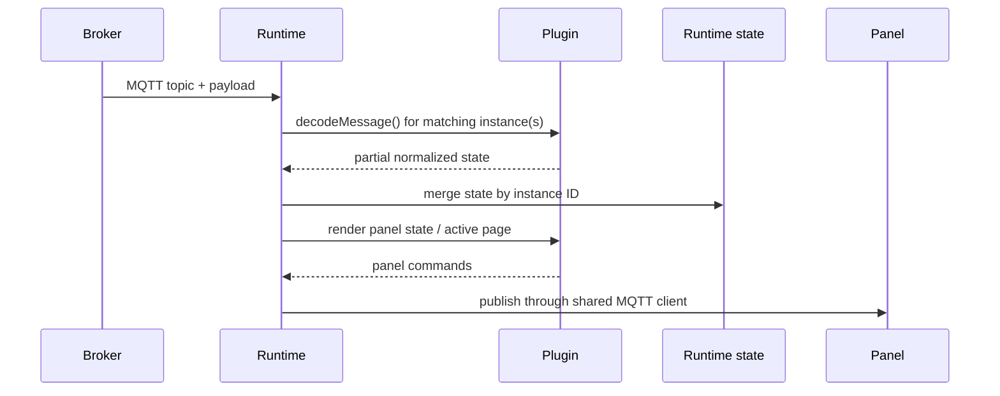

# Plugin Runtime and MQTT Message Flow

## Overview

The API owns one MQTT connection and acts as the coordinator between the broker, configured plugin instances, and NSPanel firmware. Plugins translate device or service data into normalized state and panel commands. They do not open their own broker connections.

The main implementation points are [`server.ts`](../apps/api/src/server.ts), [`default-plugin-registry.ts`](../apps/api/src/features/plugins/default-plugin-registry.ts), [`plugin-contract.ts`](../apps/api/src/features/plugins/plugin-contract.ts), [`mqtt-runtime.ts`](../apps/api/src/services/mqtt-runtime.ts), and [`runtime-state-store.ts`](../apps/api/src/features/runtime/runtime-state-store.ts).

## Profiles, Instances, and Bindings

A **plugin profile** selects a plugin type and stores its reusable configuration, such as MQTT topic templates or device behavior. A **plugin instance** gives that profile a device-specific name and variables. This lets several devices use one profile with different topic names or identifiers. Runtime resolution combines the profile and instance into a `ResolvedPluginInstance` before calling plugin methods.

Panels refer to instances in different ways: native page assignments in `panel.nativePluginInstances`, page-event observers in `panel.panelEventPluginInstances`, home tile assignments on panel buttons, or favorite bindings for plugin flows. The plugin API routes validate and save these settings, then ask the runtime to refresh instances.

## Initialization and Subscriptions

At server startup, `createDefaultPluginRegistry()` registers the built-in scripted MQTT, scripted group MQTT, thermostat, weather, light, cover, favorites, Sonos, and screen dimmer plugins. The runtime resolves enabled instances and initializes each whose plugin type, version, configuration, or variables changed. An optional `initialize()` hook can set up startup behavior and return callback subscriptions. For example, scripted plugins use this to register `mqtt.subscribe(topic, callback)` handlers.

The runtime combines and deduplicates panel event filters (`<nodeName>/event/#`), configured route sources, each plugin instance’s `subscriptions(instance)`, and startup callback filters. On broker connection or configuration changes it subscribes to additions and removes obsolete filters. Plugins receive the shared runtime context for publishing, scoped storage, and logging.

## Incoming MQTT Message Flow

Each broker packet becomes a `MqttMessageEnvelope` with topic, payload text, QoS, retain flag, and receive time. The runtime then:

1. Identifies whether the topic belongs to a configured panel and updates panel page/session tracking for navigation events.
2. Checks every enabled plugin instance whose declared topic filters match. `decodeMessage()` parses that packet and returns a partial state update. The runtime merges it into that instance’s cached state.
3. Invokes any matching startup callback subscriptions through `handleSubscription()`. These can update state, publish commands, or request page navigation.
4. Routes panel-specific events to the assigned native page plugin, assigned page-event observers, favorite flow, or home tile handler as applicable. Page-event observers receive `<nodeName>/event/page/<pageId>` events even when they do not own that firmware page; the screen dimmer uses this to publish `dims=<value>` to `<nodeName>/cmnd/nextion`.
5. Applies matching generic MQTT routes, independently of plugin dispatch.

The runtime does not infer a plugin from a topic prefix: it checks the filters returned by every enabled instance, and dispatches to each match. This allows multiple configured devices to listen to related topics. The plugin’s decoder decides whether a matching payload contains useful state; returning no patch leaves the state unchanged.



## State, Rendering, and Outbound Commands

Normalized device state is cached by plugin instance and restored from a bounded last-known snapshot when the manager restarts. The snapshot is coalesced to at most one disk write per second and is capped at 64 KiB per instance, 512 instances, and 2 MiB total; oversized or evicted state remains available in memory until restart. `renderPanelState()` can publish assigned summary data, while `renderNativePanelState()` translates state for a firmware-owned page. Native page state is generally sent only while that page is open; integrations can opt into background updates when the firmware needs shared data, as Sonos does for its player list. Weather obtains state through `poll()` on its configured interval instead of an MQTT subscription.

Panel actions follow the reverse path: the runtime decodes the firmware event, calls the relevant plugin handler, and publishes returned `PluginCommand`s. Script helpers such as `mqtt.send()` use the same runtime publisher. The runtime also handles firmware setup messages, including panel settings on boot, separately from plugin state rendering.

## Scripted Group MQTT

The Scripted group MQTT plugin handles the manager input topic
`nspanelmanager/groups/<group>/cmnd/settings`. Create an instance with the
matching panel group name. Its script receives the incoming parsed JSON as
`payload` and `message.payload`, plus `group.name` and `group.panels`. Each
panel entry includes its display name, ID, active MQTT topic root in
`nodeName`, and a unique `requestId` for group-settings acknowledgements.
Scripts call `mqtt.send(topic, payload)` for each output. The runtime rejects
topics outside the configured group and publishes accepted commands with a
100 ms gap. If no scripted instance matches a group, the existing built-in
night and brightness behavior remains active. Valid night/brightness inputs
continue to be saved and replayed after a panel reconnect; replay invokes the
script for the reconnecting panel only.

Example transform:

```js
for (const panel of group.panels) {
  mqtt.send(panel.nodeName + "/cmnd/group/settings", {
    ...payload,
    request_id: panel.requestId
  });
}
```

Ordinary MQTT-derived plugin state is now written to the private runtime-state file as a bounded last-known snapshot. State is updated immediately in memory and coalesced to at most one write per second; a forced termination can lose updates since the last successful snapshot. Scripts can still explicitly persist additional values through global, plugin-instance, or panel storage; those writes share the same batched snapshot. Panel flow sessions are also persisted so an interactive flow can be restored.

## Extending the System

Implement the relevant methods in `PluginDefinition`, including `subscriptions()`, `decodeMessage()`, and the event/render hooks needed by the integration. Register the class in `createDefaultPluginRegistry()`. Keep topic parsing and device-specific translation in the plugin; leave broker subscription management, state dispatch, panel publishing, and lifecycle management to `MqttRuntime`.
